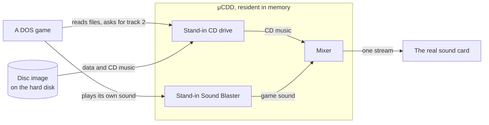

# μCDD fork: a CD drive in software for DOS, and a harness that checks it game by game

**Nearly all of this fork's changes were written by an AI (Claude); one
person directed and tested them.** As of 11 November 2026.

## What this is, in half a minute

In the 1990s many PC games came on a CD and played their music straight off
the disc, the way a CD player would. To run such a game on a real PC of that
era today, the disc has to be in the drive.

[μCDD](https://github.com/vorvek/uCDD), written by vorvek, is a small DOS
program that stands in for the drive. It reads a copy of the disc from the
hard disk, and it plays the disc's music through the sound card, mixed with
the game's own sound. Think of it as a stand-in for the CD drive with a
sound engineer attached: the game believes it is talking to a drive and a
sound card, and the stand-in passes on what a real drive and card would
have produced.

This repository is a **fork** of that driver. It did two things:

1. It changed the driver (an ESS AudioDrive sound path, fixes, measuring
   tools). That work has been paused since 24 October 2026.
2. It built a **test harness**: an emulated 1990s PC that launches each of
   838 games three ways (no driver, this fork's driver, the author's
   driver), records the screen and the sound, and reports where a game
   behaves differently with the driver than without it.

All credit for the driver is the upstream author's.

## Where it stands

- The harness has run its unit, driver and sound-card tests, calibrated
  itself on 84 games known to work, and swept the 838-game library.
- It has 169 rows of candidate faults on record, in this fork's driver, in
  the author's releases, or in both, and groups them into families by what
  they share ([docs/KNOWN-ISSUES.md](docs/KNOWN-ISSUES.md)).
- **No candidate fault has been confirmed on real hardware yet.** The
  harness's results were measured in an emulator; the fork's own testing
  before the harness, on the real PC, is in
  [docs/FEATURES.md](docs/FEATURES.md).

The page that changes as the work moves is [docs/STATUS.md](docs/STATUS.md).

> [!IMPORTANT]
> The source tree on this branch (`fixes`) is the fork's line as it stood on
> 20 October 2026. The driver these pages test and describe is on the
> [`count-position`](https://github.com/TrongDog/uCDD/tree/count-position)
> branch. [docs/REFERENCE.md](docs/REFERENCE.md#builds) says which build is
> which.

> [!NOTE]
> If you only want to play games, use the
> [author's release](https://github.com/vorvek/uCDD). This fork is a test
> bed with known faults, listed in [docs/KNOWN-ISSUES.md](docs/KNOWN-ISSUES.md).

## Where to go next

| I want to... | Read |
|---|---|
| see how far the work has got | [docs/STATUS.md](docs/STATUS.md) |
| build the driver and hear a CD game | [docs/QUICKSTART.md](docs/QUICKSTART.md) |
| do one thing (several discs, a game that will not start, an ESS card) | [docs/HOWTO.md](docs/HOWTO.md) |
| fix a problem I am having | [docs/TROUBLESHOOTING.md](docs/TROUBLESHOOTING.md) |
| look up a command, an option, a build or a term | [docs/REFERENCE.md](docs/REFERENCE.md) |
| see every fault found, and in which version | [docs/KNOWN-ISSUES.md](docs/KNOWN-ISSUES.md) |
| understand how the driver and the harness are put together | [docs/ARCHITECTURE.md](docs/ARCHITECTURE.md) |
| judge whether a result can be trusted | [docs/METHOD.md](docs/METHOD.md) |
| read the experiments, with their numbers | [docs/EXPERIMENTS.md](docs/EXPERIMENTS.md) |
| know why things were done this way, and what was tried and dropped | [docs/DECISIONS.md](docs/DECISIONS.md) |
| see the sources and who is owed credit | [docs/REFERENCES.md](docs/REFERENCES.md) |

Every page, by kind, is listed in [docs/README.md](docs/README.md).

The working record behind all of them is
[ISSUES.md on `notes`](https://github.com/TrongDog/uCDD/blob/notes/ISSUES.md):
long, in the order it was written, every row a claim with its evidence.

## Licence

GPL-3.0-only, as upstream ([LICENSE](LICENSE)). The harness's own scripts
are under the same licence. No game files, disc images, boot disks,
firmware or recordings are in this repository.
