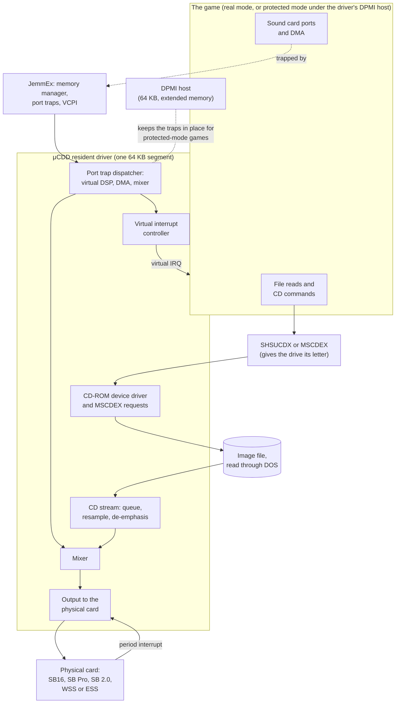
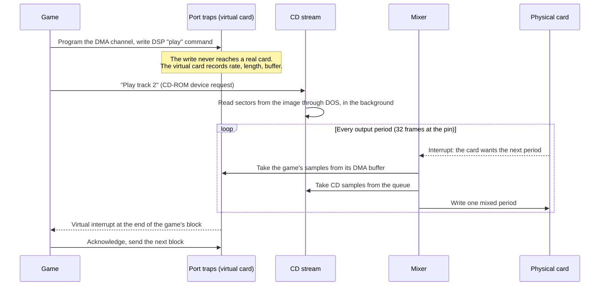
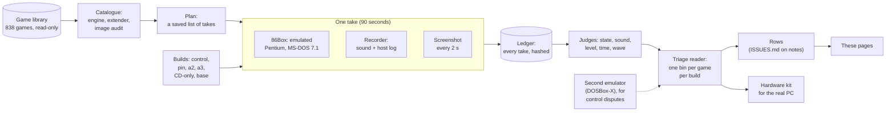
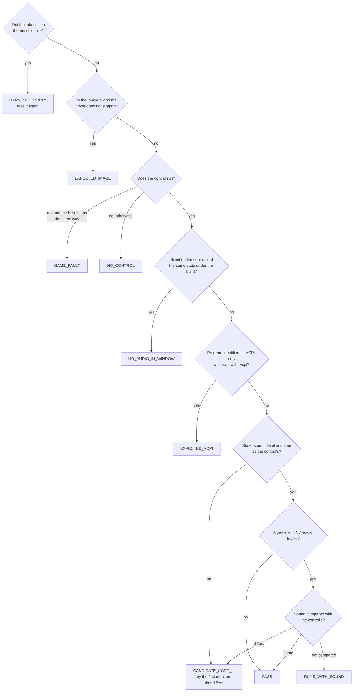

# Architecture: the driver, the harness and the repository

Written by Claude. As of 10 November 2026. This page is the map. It says
what the parts are and where each lives, with a link into the source. It
does not argue for anything; the reasons are in
[DECISIONS.md](DECISIONS.md), and how a result is produced is in
[METHOD.md](METHOD.md).

Source links go to the `count-position` branch, the line the harness
tests. The source on this branch (`fixes`) is an older line; see
[REFERENCE.md](REFERENCE.md#builds).

A part's role below is taken from one of three places, and the table says
which: the size table in the build page of that branch ("build page"), the
comment at the top of the file ("file header"), or, where neither says,
the file's name ("by name"). A role given "by name" is orientation, not a
finding.

## 1. The driver

### In one picture

### What happens when a game plays a sound while the disc plays music

The mixer's unity gain halves each sample before the disc's music and the
game's samples are added; its own comment says that is so the sum needs
no clipping. *Hypothesis* (the row's): this is why disc music measures
6 dB under the bare card on every build
([CAND-27](FINDINGS.md#cand-27)).

### The parts and where they live

| Part | Files | Role from |
|---|---|---|
| Installer and command line | [`src/ucdd.asm`](https://github.com/TrongDog/uCDD/blob/count-position/src/ucdd.asm), [`src/helper.asm`](https://github.com/TrongDog/uCDD/blob/count-position/src/helper.asm) | by name; the help text is in `helper.asm` |
| CD-ROM device driver, MSCDEX requests | [`src/driver.asm`](https://github.com/TrongDog/uCDD/blob/count-position/src/driver.asm) | build page |
| CUE sheet parser | [`src/cue.asm`](https://github.com/TrongDog/uCDD/blob/count-position/src/cue.asm) | by name |
| Multi-disc lists and hotkeys | [`src/mdm.asm`](https://github.com/TrongDog/uCDD/blob/count-position/src/mdm.asm) | build page |
| Disk controller IRQs passed to DOS | [`src/disk_scan.asm`](https://github.com/TrongDog/uCDD/blob/count-position/src/disk_scan.asm) | file header |
| Port trap dispatcher: virtual DSP, DMA and mixer | [`src/audio/trap.asm`](https://github.com/TrongDog/uCDD/blob/count-position/src/audio/trap.asm), [`src/audio/sb_mixer.asm`](https://github.com/TrongDog/uCDD/blob/count-position/src/audio/sb_mixer.asm), [`src/audio/sb_adpcm.asm`](https://github.com/TrongDog/uCDD/blob/count-position/src/audio/sb_adpcm.asm) | build page; the last two by name |
| Single-cycle block patch (short effects) | [`src/audio/sb_patch.asm`](https://github.com/TrongDog/uCDD/blob/count-position/src/audio/sb_patch.asm) | build page |
| Virtual interrupt controller | [`src/audio/irq.asm`](https://github.com/TrongDog/uCDD/blob/count-position/src/audio/irq.asm) | build page, file header |
| Virtual WSS codec | [`src/audio/wss_codec.asm`](https://github.com/TrongDog/uCDD/blob/count-position/src/audio/wss_codec.asm) | build page |
| Virtual ESS AudioDrive | [`src/audio/ess/card.asm`](https://github.com/TrongDog/uCDD/blob/count-position/src/audio/ess/card.asm), [`src/audio/ess_fifo.asm`](https://github.com/TrongDog/uCDD/blob/count-position/src/audio/ess_fifo.asm) | by name; specification [`docs/vess-spec.md`](https://github.com/TrongDog/uCDD/blob/count-position/docs/vess-spec.md) |
| CD streaming, queue, XMS | [`src/audio/mounted.asm`](https://github.com/TrongDog/uCDD/blob/count-position/src/audio/mounted.asm), [`src/audio/stream.asm`](https://github.com/TrongDog/uCDD/blob/count-position/src/audio/stream.asm), [`src/audio/background.asm`](https://github.com/TrongDog/uCDD/blob/count-position/src/audio/background.asm) | build page; the last two by name |
| Seek cache for the image file | [`src/audio/disk_cache.asm`](https://github.com/TrongDog/uCDD/blob/count-position/src/audio/disk_cache.asm) | build page, file header |
| CD resampling, de-emphasis | [`src/audio/cd_resample.asm`](https://github.com/TrongDog/uCDD/blob/count-position/src/audio/cd_resample.asm), [`src/audio/deemphasis.asm`](https://github.com/TrongDog/uCDD/blob/count-position/src/audio/deemphasis.asm) | build page, file header |
| Mixer, general loop and fast paths | [`src/audio/mix.asm`](https://github.com/TrongDog/uCDD/blob/count-position/src/audio/mix.asm), [`src/audio/mix_run.asm`](https://github.com/TrongDog/uCDD/blob/count-position/src/audio/mix_run.asm) | build page, file header |
| Physical output: SB16 and ESS | [`src/audio/sb16.asm`](https://github.com/TrongDog/uCDD/blob/count-position/src/audio/sb16.asm) | build page |
| Physical output: SB Pro | [`src/audio/pro_output.asm`](https://github.com/TrongDog/uCDD/blob/count-position/src/audio/pro_output.asm) | build page |
| Physical output: WSS | [`src/audio/wss_output.asm`](https://github.com/TrongDog/uCDD/blob/count-position/src/audio/wss_output.asm) | build page |
| JemmEx port-trap backend | [`src/audio/host_jemm.asm`](https://github.com/TrongDog/uCDD/blob/count-position/src/audio/host_jemm.asm), [`src/audio/host_jemm_init.asm`](https://github.com/TrongDog/uCDD/blob/count-position/src/audio/host_jemm_init.asm) | build page |
| Stepping aside, and the rule for it | [`src/audio/standby.asm`](https://github.com/TrongDog/uCDD/blob/count-position/src/audio/standby.asm), [`src/audio/pairing.asm`](https://github.com/TrongDog/uCDD/blob/count-position/src/audio/pairing.asm) | file header |
| DMA buffers above 1 MB | [`src/audio/high_dma.asm`](https://github.com/TrongDog/uCDD/blob/count-position/src/audio/high_dma.asm) | file header |
| Chipset DMA timing (fast DMA) | [`src/platform.asm`](https://github.com/TrongDog/uCDD/blob/count-position/src/platform.asm) | by name; specification [`docs/platform-dma.md`](https://github.com/TrongDog/uCDD/blob/count-position/docs/platform-dma.md) |
| DPMI host: entry, exit, services | [`src/host/dpmi.asm`](https://github.com/TrongDog/uCDD/blob/count-position/src/host/dpmi.asm) | build page |
| DPMI host: monitor, instruction decoder, exceptions | [`src/host/monitor.asm`](https://github.com/TrongDog/uCDD/blob/count-position/src/host/monitor.asm) | build page |
| DPMI host: interrupts, virtual PIC, real-mode switch | [`src/host/interrupts.asm`](https://github.com/TrongDog/uCDD/blob/count-position/src/host/interrupts.asm), [`src/host/pic.asm`](https://github.com/TrongDog/uCDD/blob/count-position/src/host/pic.asm), [`src/host/switch.asm`](https://github.com/TrongDog/uCDD/blob/count-position/src/host/switch.asm) | build page |
| DPMI host: DOS calls for 16-bit clients | [`src/host/dos.asm`](https://github.com/TrongDog/uCDD/blob/count-position/src/host/dos.asm), [`src/host/dos16.asm`](https://github.com/TrongDog/uCDD/blob/count-position/src/host/dos16.asm) | build page, file header |
| DPMI host: memory, descriptors, nested programs | [`src/host/memory.asm`](https://github.com/TrongDog/uCDD/blob/count-position/src/host/memory.asm), [`src/host/descriptors.asm`](https://github.com/TrongDog/uCDD/blob/count-position/src/host/descriptors.asm), [`src/host/nested.asm`](https://github.com/TrongDog/uCDD/blob/count-position/src/host/nested.asm) | build page |
| UCDDSET, the setup program | [`src/setup.asm`](https://github.com/TrongDog/uCDD/blob/count-position/src/setup.asm), [`src/setup/config_file.asm`](https://github.com/TrongDog/uCDD/blob/count-position/src/setup/config_file.asm), [`src/setup/detect.asm`](https://github.com/TrongDog/uCDD/blob/count-position/src/setup/detect.asm) | file header |
| UCDDPLAY, the CD player | [`src/play.asm`](https://github.com/TrongDog/uCDD/blob/count-position/src/play.asm) | file header |
| The build | [`scripts/build.py`](https://github.com/TrongDog/uCDD/blob/count-position/scripts/build.py) | [../BUILDING.md](../BUILDING.md) |

The fork's own specifications, written before the code they describe:
the virtual Sound Blasters ([`docs/vsb-spec.md`](https://github.com/TrongDog/uCDD/blob/count-position/docs/vsb-spec.md)), the virtual ESS
([`docs/vess-spec.md`](https://github.com/TrongDog/uCDD/blob/count-position/docs/vess-spec.md)), the DPMI host's CD-ROM calls
([`docs/host-cdrom-spec.md`](https://github.com/TrongDog/uCDD/blob/count-position/docs/host-cdrom-spec.md)), the ESS FIFO ([`docs/ess-fifo.md`](https://github.com/TrongDog/uCDD/blob/count-position/docs/ess-fifo.md)).

In memory after install: a driver image of 42 KB (34 KB permanent), with
the CD work buffer (6 KB), the output ring, the tail cache (2 KB) and the
host's real-mode gateway and stack (7 KB) beside it; the 64 KB host image
is in extended memory. The figures, piece by piece, are in the build page
([../BUILDING.md](../BUILDING.md), "Size limits and what takes the room").

[TODO: Insert a diagram of the DPMI host's own parts (ring-0 monitor, V86
task, client at ring 3) once a row or specification describes them; none
on the public branches does yet.]

## 2. The harness

### In one picture

Each box, in a sentence:

- **Catalogue.** One line per game: how it is launched, its disc image,
  its sound engine and its DOS extender, read from the files and never
  guessed (UNKNOWN is a value).
- **Plan and take.** A plan is a list of takes saved before it runs. A
  take boots the emulated PC, loads one build of the driver (or none),
  launches one game and leaves it alone for 90 seconds.
- **Recorder.** Captures the emulator's sound and logs, on the host's
  clock, every buffer handed over and every underrun, so a silence can be
  told apart from a recorder fault ([BENCH.md](BENCH.md)).
- **Judges.** Each compares a driver take with the control take of the
  same game: its run state, whether it sounds and when, its level, and for
  part of the library the sound itself, piece by piece.
- **Ledger.** Append-only. Each take's entry carries the hashes of the
  driver files, the disk image, the boot and the capture.
- **Triage reader.** Reads the tables the judges made and gives each game
  one bin per build ([REFERENCE.md](REFERENCE.md#bins)).
- **Rows and pages.** A fault becomes a row with its evidence; the pages
  are a readable view of the rows.

### How a game gets its bin

### Where the harness's code is

| Part | Where | Public |
|---|---|---|
| The runners, the recorder, the judges, the catalogue, the triage reader, the results | The bench repository | No. It runs beside the game library and its results name game files. |
| The ledger, the decisions, the lessons | The bench machine | No. Never pushed anywhere. |
| The commit checks, the ledger's rules, the test matrix, the privacy and page checks | The method package: [`lib/`](https://github.com/TrongDog/uCDD/blob/claude/brave-franklin-6h9xzo/lib), [`tools/`](https://github.com/TrongDog/uCDD/blob/claude/brave-franklin-6h9xzo/tools), [`tests/`](https://github.com/TrongDog/uCDD/blob/claude/brave-franklin-6h9xzo/tests), [`method.toml`](https://github.com/TrongDog/uCDD/blob/claude/brave-franklin-6h9xzo/method.toml) | Yes |
| The GitHub workflow that runs the checks | [`.github/workflows/method.yml`](../.github/workflows/method.yml) | Yes |
| The rows | [ISSUES.md on `notes`](https://github.com/TrongDog/uCDD/blob/notes/ISSUES.md) | Yes |
| The data sheets and specifications, as text | The [`reference-library`](https://github.com/TrongDog/uCDD/tree/reference-library) branch | Yes |

## 3. The repository

| Branch | Holds |
|---|---|
| `main` | The upstream releases, unchanged. |
| `fixes` | These pages, and the fork's combined line to 20 October 2026, kept for its history. `ISSUES.md`, `BUILDING.md` and `RELEASE-NOTES.md` here describe that line as it was then. |
| `count-position` | The fork's line, the build the harness pins. |
| `merge-a6` | The fork's line with upstream 0.9.4-a6 merged in; built, not run. |
| `feature/disk-irq`, `feature/step-aside`, `feature/fast-dma`, `feature/ess` | The feature branches, each one change on upstream 0.9.4-a6. Disk-irq, step-aside and fast-dma now exist upstream in 0.9.5-a2, in the author's own form; upstream has also dropped Microsoft EMM386, as the fork had. |
| `play-harness` | UCDDPLAY, the CD player: a reference pass against its own specification, a faster FFT and scroller, and `scripts/playcheck`, which runs the player against an earlier build of itself and compares the output. |
| `notes` | The harness's rows: ISSUES.md, the index of fixes, the specifications the fork wrote for itself. |
| `claude/brave-franklin-6h9xzo` | The method package: the commit checks, the ledger, the test matrix, the GitHub workflow. |
| `sound-engine-library`, `reference-library`, `spec-first` | The game-engine census, text copies of the data sheets and specifications, and the design notes. |

Earlier working branches live on as `archive/<name>` tags.

Which features are in which branch's source:

| Feature | `fixes` (this branch) | `count-position` (the pin) |
|---|---|---|
| Disk controller IRQs, stepping aside, fast DMA | Yes | Yes |
| Native ESS output | Yes | Yes |
| Virtual ESS AudioDrive | An earlier form: ESS commands in front of the Sound Blaster parser, in `src/audio/trap.asm` | Rebuilt from the data sheets as a card of its own, with the chip's FIFO; a build option (`--virtual-ess`), not in the build the harness pins |
| `UCDD -status` and the interrupt counters | No | Yes |
| Virtual SB16 answering as DSP 4.13 | No (4.05) | Yes |
| 512-frame output ring | No (two periods) | Yes |

The fork's own history was rewritten on 10 November 2026: commit messages,
file wording and commit dates only, no code. Commit ids from before that
date differ; the upstream releases on `main` keep theirs.
